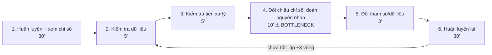
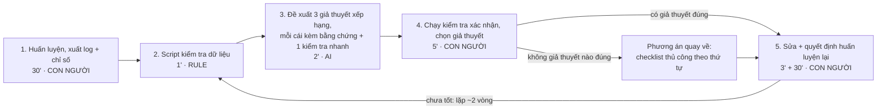

# Báo cáo nhóm — Day 02 Discovery & Problem Framing

> Bản chung của nhóm. Khi chốt bản cuối, **mỗi thành viên copy file này vào repo cá nhân**.
> Template chi tiết và prompt mẫu: [docs/01-worksheet.md](../../docs/01-worksheet.md). Bài mẫu: [docs/02-deliverable-example.md](../../docs/02-deliverable-example.md).

## 1. Thông tin nhóm

- Tên nhóm: Nhóm 4.1
- Thành viên: xem `TEAM.md`
- Candidate problem được chọn (1 câu): Sinh viên làm bài ML/DL phải huấn luyện lại nhiều vòng (mỗi vòng 15–60 phút) vì đoán nguyên nhân mô hình cho kết quả kém, thay vì kiểm tra có thứ tự dữ liệu, tiền xử lý và chỉ số.
- Quyết định cuối: **Go, phạm vi nhỏ** (pilot không xây công cụ mới, có ngưỡng dừng)

---

## 2. Hội tụ nhóm (CP3)

### 2.1. Pitch

| # | Người đưa ra | Candidate (Job Story ngắn) | Actor | Bottleneck | Câu hỏi phản biện nhận được (ai hỏi) |
|---:|---|---|---|---|---|
| 1 |Nguyễn Ngọc Sang |#1 – So sánh báo giá nhà cung cấp: Khi nhận nhiều báo giá từ các nhà cung cấp, nhân viên mua hàng cần tổng hợp và so sánh giá, số lượng, chiết khấu và điều kiện giao hàng để lựa chọn nhà cung cấp phù hợp. |Nhân viên mua hàng (Procurement Staff), Quản lý mua hàng (Procurement Manager), Kế toán. |Trích xuất, chuẩn hóa và tổng hợp dữ liệu từ nhiều file Excel/PDF có định dạng khác nhau; mất khoảng 35–40 phút. |Quản lý mua hàng: Làm thế nào đảm bảo AI đọc chính xác báo giá từ nhiều định dạng khác nhau? AI có đánh giá được điều kiện giao hàng và thanh toán thay vì chỉ chọn giá thấp nhất không? |
| 2 |Nguyễn Ngọc Sang |#2 – Tra cứu chính sách bảo hành: Khi khách hàng hỏi về bảo hành, nhân viên cần tra cứu thông tin sản phẩm, ngày mua và lịch sử sửa chữa để đưa ra câu trả lời chính xác. |Nhân viên chăm sóc khách hàng (Customer Service), Nhân viên kỹ thuật (Technical Support), Quản lý bảo hành. |Tìm kiếm chính sách và đối chiếu thông tin từ nhiều nguồn; mất khoảng 4–6 phút. |Nhân viên chăm sóc khách hàng: Làm thế nào đảm bảo câu trả lời của AI đúng với chính sách hiện hành? Nếu thông tin sản phẩm hoặc lịch sử sửa chữa không đầy đủ thì AI xử lý thế nào? |
| 3 |Nguyễn Ngọc Sang |#3 – Kiểm tra yêu cầu mua hàng: Khi nhận yêu cầu mua hàng từ các phòng ban, nhân viên cần kiểm tra thông tin, ngân sách và trạng thái phê duyệt trước khi chuyển sang bước xử lý tiếp theo. |Nhân viên mua hàng, Quản lý mua hàng, Nhân viên phòng ban đề xuất, Kế toán. |Kiểm tra ngân sách, trạng thái phê duyệt và xử lý hồ sơ thiếu thông tin; mất khoảng 5–7 phút. |Kế toán: AI dựa vào đâu để xác định yêu cầu vượt ngân sách hoặc chưa được phê duyệt? Làm thế nào tránh việc AI đánh giá sai và chuyển tiếp yêu cầu không hợp lệ? |
| 4 |Đào Thị Thu Phương |Khi nhận yêu cầu từ nhiều phòng ban qua email, Word và Excel, tôi muốn tổng hợp và chuẩn hóa các yêu cầu thành một danh sách thống nhất để tránh bỏ sót thông tin. |Business Analyst, Project Manager, các phòng ban |Đọc, trích xuất và đối chiếu yêu cầu từ nhiều nguồn, mất khoảng 120–180 phút/lần. |AI có thể đọc hiểu chính xác các định dạng tài liệu khác nhau không? Làm thế nào để tránh bỏ sót hoặc hiểu sai yêu cầu? (AI phản biện) |
| 5 |Đào Thị Thu Phương |Khi hoàn thành BRD, SRS, User Stories và Test Cases, tôi muốn kiểm tra tính nhất quán giữa các tài liệu để phát hiện yêu cầu bị thiếu hoặc mâu thuẫn. |Business Analyst, Developer, Tester |Đối chiếu nội dung và phát hiện sai lệch giữa các tài liệu, mất khoảng 120–180 phút/lần. |AI có thể phát hiện chính xác các sai lệch về ngữ nghĩa và quy tắc nghiệp vụ không? (AI phản biện) |
| 6 |Đào Thị Thu Phương |Khi kết thúc cuộc họp với khách hàng và đội phát triển, tôi muốn tự động tạo Meeting Minutes và Action Items để tiết kiệm thời gian ghi chép và tránh bỏ sót công việc. |Business Analyst, Project Manager, Developer, Tester |Nghe lại bản ghi, tổng hợp nội dung và xác định người phụ trách, deadline, mất khoảng 30–45 phút/cuộc họp. |AI có thể nhận diện chính xác người phát biểu, quyết định, người phụ trách và deadline không? (AI phản biện) |
| 7 | Nguyễn Khôi Nguyên | Khi code Python cho kết quả sai, muốn tìm nhanh nguyên nhân để không thử sửa nhiều lần | SV làm bài lập trình | Bước thử sửa theo phỏng đoán (vòng lặp sửa → chạy lại, ~6') | Debugger + unit test đã đủ chưa, cần gì thêm? |
| 8 | Nguyễn Khôi Nguyên | Khi mô hình ML/DL cho kết quả kém, muốn đối chiếu dữ liệu, tiền xử lý, chỉ số để tìm nguyên nhân | SV làm bài ML/DL | Bước đối chiếu chỉ số và đoán nguyên nhân (~10'), mỗi lần đoán sai tốn thêm 1 vòng huấn luyện 15–60' | Nếu không có AI, cách đơn giản nhất để giảm một nửa số vòng là gì? |
| 9 | Nguyễn Khôi Nguyên | Khi chương trình/huấn luyện chạy chậm, muốn tìm đoạn tốn thời gian | SV lập trình, ML/DL | Bước đoán đoạn chậm và thêm lệnh đo giờ (~15') | Chậm do code hay do phần cứng/dữ liệu lớn |
| 10 |Nguyễn Trần Tiến |#1 – Debug firmware phần cứng: Khi lập trình phần cứng cho hệ thống đồ án tốt nghiệp, tôi muốn tra cứu và đồng bộ thông số datasheet với code firmware, để hệ thống kiểm thử đạt hiệu suất tốt nhất và không đọc sai thông số. |Sinh viên làm đồ án tốt nghiệp (bản thân tôi), team, thầy hướng dẫn. |Sửa code firmware và dò lỗi ngoại vi (bước 6 trong 7 bước); mất khoảng 90 phút/lần (ước lượng), tổng ~10–12 giờ/tuần trong khoảng 2 tháng. |Câu hỏi tôi muốn nhóm phản biện: Agent AI có thật sự giúp tự động hóa khâu dò lỗi phần cứng ngoại vi vốn phụ thuộc nhiều vào tính chất vật lý của linh kiện hay không, hay chỉ nên dùng quy trình Rule-based để kiểm tra cú pháp cấu hình thanh ghi? |
| 11 |Nguyễn Trần Tiến |#2 – Đẩy dữ liệu cảm biến lên Cloud: Khi lập trình xong phần cứng firmware, tôi muốn truyền tải dữ liệu cảm biến lên đám mây, để lấy dữ liệu phục vụ huấn luyện hệ thống và cảnh báo qua giao diện web. |Sinh viên làm đồ án tốt nghiệp (bản thân tôi), team, thầy hướng dẫn. |Xử lý mất gói tin và kiểm tra độ ổn định đường truyền (bước 6 trong 7 bước); mất khoảng 120 phút/phiên (ước lượng), tổng 2–3 giờ/ngày trong hơn 2 tuần. |Điều tôi còn chưa chắc: độ ổn định của đường truyền mạng và cơ chế đồng bộ gói tin khi test thực tế. |
| 12 |Nguyễn Trần Tiến |#3 – Hỗ trợ thành viên mới định dạng tệp dữ liệu: Khi hướng dẫn thành viên mới định dạng tệp dữ liệu, tôi muốn tệp dữ liệu của các bạn đúng chuẩn ngay từ đầu, để không phải mất nhiều giờ ngồi kiểm tra và chỉ ra từng dòng lỗi thủ công. |Người hướng dẫn (bản thân tôi), thành viên mới trong lớp lab, team, thầy hướng dẫn. |Mở tệp JSONL dò từng dòng để tìm chỗ sai (bước 5 trong 7 bước); mất khoảng 45 phút/đợt (ước lượng), tổng ~110 phút/đợt, 1–2 lần/tháng. |Điều tôi còn chưa chắc: mức độ tự giác của thành viên mới trong việc chạy công cụ kiểm tra trước khi nhờ hỗ trợ. |

### 2.2. Cluster

| Cluster | Các candidate | Pattern chung |
|---|---|---|
| A — Tổng hợp, đối chiếu thông tin từ nhiều tài liệu khác định dạng | #1 (báo giá), #4 (yêu cầu từ nhiều phòng ban), #5 (nhất quán BRD/SRS/test case), #6 (biên bản họp) | Đọc nhiều file Excel/PDF/Word/email hoặc bản ghi, trích xuất và đối chiếu thủ công; mất 30–180 phút/lần; dữ liệu thường là tài liệu nội bộ |
| B — Kiểm tra theo quy tắc hoặc chính sách có sẵn | #2 (tra chính sách bảo hành), #3 (kiểm tra yêu cầu mua hàng vs ngân sách), #12 (kiểm tra định dạng JSONL) | Đối chiếu một hồ sơ với quy tắc đã biết (chính sách, ngân sách, schema); phần lớn là đúng/sai rõ ràng nên Rule có thể giải được nhiều |
| C — Tìm nguyên nhân lỗi kỹ thuật bằng thử–sai | #7 (code Python sai), #8 (mô hình ML/DL kém), #9 (chạy chậm), #10 (firmware/ngoại vi), #11 (mất gói tin lên Cloud) | Không có thông báo lỗi rõ, phải đoán nguyên nhân rồi chạy lại; mỗi lần đoán sai tốn một vòng thử 1–120 phút |

### 2.3. Opportunity Solution Tree rút gọn

Gốc là **1 outcome**. Nhánh là **opportunity** (nhu cầu, pain), không phải tính năng hay công cụ.

```text
OUTCOME: Giảm số vòng thử–sai và tổng thời gian để tìm ra nguyên nhân lỗi trong bài tập/đồ án kỹ thuật
├── Opportunity A: Khi kết quả sai mà không có thông báo lỗi, người làm không biết nên kiểm tra gì trước (#7, #8, #10)
├── Opportunity B: Mỗi giả thuyết sai tốn một vòng chạy lại dài: huấn luyện 15–60', nạp và test firmware ~90' (#8, #10, #11)
└── Opportunity C: Lỗi nằm ở dữ liệu hoặc cấu hình (nhãn, chuẩn hóa, thanh ghi, định dạng file) hay bị bỏ qua, người làm chỉnh tham số/code trước (#8, #10, #12)
```

Những ý đã gạch bỏ vì là solution đội lốt opportunity:
- ✗ "Agent AI tự động dò lỗi phần cứng ngoại vi" (từ câu hỏi ở #10): là giải pháp, chưa nói pain.
- ✗ "Tự động tạo Meeting Minutes và Action Items" (#6): Job Story đang chứa sẵn cách giải; pain thật là "mất 30–45 phút nghe lại và hay bỏ sót việc".
- ✗ "Chatbot debug cho sinh viên": tên công cụ, không phải nhu cầu.
-

### 2.4. Chấm điểm shortlist (1–5)

| Candidate | Actor rõ | Quy trình rõ | Pain có bằng chứng | Impact đo được | Vừa sức lab | So sánh được No AI/Rule/Workflow/Agent | Nhóm hiểu domain | Tổng |
|---|---:|---:|---:|---:|---:|---:|---:|---:|
| #8 Chẩn đoán mô hình ML/DL kém (cluster C) | 4 | 4 | 2 | 4 | 5 | 5 | 5 | **29** |
| #4 Tổng hợp yêu cầu từ nhiều phòng ban (cluster A) | 4 | 3 | 3 | 4 | 3 | 4 | 2 | 23 |
| #10 Debug firmware phần cứng (cluster C) | 5 | 3 | 3 | 4 | 2 | 3 | 2 | 22 |

**Candidate được chọn:** #8 — Chẩn đoán nguyên nhân khi mô hình ML/DL cho kết quả kém.

**Vì sao chọn:** Mỗi lần đoán sai rất đắt (một vòng huấn luyện lại 15–60 phút), nên impact đo được rõ bằng số vòng huấn luyện lại. Bước nghẽn cần đối chiếu nhiều nguồn (chỉ số train/val, thống kê dữ liệu, code tiền xử lý), nên so sánh thật sự được giữa No AI, Rule và Workflow. Cả 4 thành viên đều học AI và đã huấn luyện mô hình, và có thể phỏng vấn học viên nhóm khác ngay trong buổi, nên kiểm chứng được trong 30 phút của CP4. Điểm yếu lớn nhất là "Pain có bằng chứng" (mới là ước lượng của 1 người), nên đây là giả định ưu tiên kiểm chứng.

**Vì sao loại các candidate còn lại:**

- #4 (và cả cluster A): pain lớn nhất nhóm (120–180 phút/lần), nhưng chỉ 1 thành viên làm BA nên nhóm khó tự đánh giá đầu ra, khó tìm người phỏng vấn trong buổi lab, và tài liệu yêu cầu của khách hàng là dữ liệu nội bộ (rủi ro Viability cao).
- #10: lỗi phụ thuộc tính chất vật lý của linh kiện, phải có phần cứng mới kiểm được đầu ra, và chỉ 1 người trong nhóm gặp. Không vừa một buổi lab.
- #7 và #9: debugger, unit test và profiler đã giải phần lớn, gần như chắc chắn là No AI.
- #12: kiểm tra định dạng JSONL giải được bằng script kiểm schema (Rule), không cần so sánh tới Workflow. Giữ lại làm ví dụ "không cần AI" nếu nhóm cần.
- #2, #3: phần lớn là đối chiếu với quy tắc có sẵn (chính sách, ngân sách), Rule đủ cho đa số trường hợp; cần quyền truy cập hệ thống nội bộ.

**Xử lý bất đồng (nếu có):** [ĐIỀN: ghi lại nếu có bạn muốn chọn candidate khác và nhóm đã thống nhất thế nào. Nếu không có thì ghi "Không có".]

---

## 3. Kiểm chứng + research giải pháp đã có (CP4)

### 3.1. Assumption Map

| # | Giả định | Loại (Value / Usability / Feasibility / Viability) | Quan trọng (1–5) | Đã có bằng chứng (1–5) | Kiểm chứng trước? |
|---:|---|---|---:|---:|---|
| 1 | Sinh viên khác cũng phải huấn luyện lại ≥ 2–3 lần trước khi tìm ra nguyên nhân mô hình kém | Value | 5 | 2 | **Có** |
| 2 | Nguyên nhân thường nằm ở dữ liệu/tiền xử lý, nhưng sinh viên lại chỉnh tham số trước | Value | 5 | 2 | **Có** |
| 3 | Phần lớn nguyên nhân thuộc một tập nhỏ có thể checklist hóa (overfit/underfit, rò rỉ dữ liệu, sai nhãn, mất cân bằng lớp, sai chuẩn hóa) | Feasibility | 4 | 3 | Có (research) |
| 4 | Một LLM đọc kết quả kiểm tra + log có thể đưa nguyên nhân thật vào top 3 giả thuyết | Feasibility | 5 | 1 | Để pilot kiểm |
| 5 | Sinh viên sẽ tự chạy kiểm tra xác nhận thay vì làm theo gợi ý một cách mù quáng | Usability | 4 | 2 | Để pilot kiểm |
| 6 | Môn học cho phép dùng AI hỗ trợ chẩn đoán (không vi phạm quy định bài tập) | Viability | 3 | 2 | Hỏi giảng viên trước pilot |

*Điền 4–6 giả định; xóa dòng thừa.*

Giả định nhóm kiểm chứng trong buổi này: #1 và #2 (phỏng vấn + survey), #3 (research).

### 3.2. Kiểm chứng

Cách đã dùng: Phỏng vấn 2–3 người / Survey 5–10 người — ghi rõ thời điểm và kênh hỏi
Interview snapshot (mỗi buổi phỏng vấn một bảng, hoặc đặt file trong `report/assets/cp4-interview-snapshot-N.md`):

| Trường | Nội dung |
|---|---|
| Người được hỏi (vai trò, không ghi tên thật) | |
| Câu nói đáng nhớ nhất (nguyên văn) | |
| Lần gần nhất gặp vấn đề này: chuyện gì đã xảy ra? | |
| Hiện đang xử lý bằng cách nào (workaround)? | |
| Mất bao lâu, bao lần? | |
| Insight / opportunity rút ra | |

Tổng hợp:

| Nguồn | Số người / số mẫu | Tín hiệu xác nhận | Tín hiệu phản bác |
|---|---:|---|---|
| | | | |

**Nhóm đã sửa problem thế nào sau kiểm chứng:**

### 3.3. Research giải pháp đã có

| Công cụ / case / pattern | Link | Giải bước nào trong quy trình? | Điểm mạnh | Khoảng trống / rủi ro | Bài học cho nhóm |
|---|---|---|---|---|---|
| Deepchecks (thư viện kiểm tra dữ liệu và mô hình, có bộ Train-Test Validation) | https://github.com/deepchecks/deepchecks · https://docs.deepchecks.com/0.8/user-guide/tabular/auto_quickstarts/plot_quick_train_test_validation.html | Bước 2–3: kiểm tra toàn vẹn dữ liệu, trùng mẫu train/test, lệch phân phối | Chạy tự động, có sẵn, miễn phí | Ra nhiều kết quả cùng lúc, không xếp hạng cái nào là nguyên nhân chính, sinh viên khó đọc | Phần kiểm tra dữ liệu làm được bằng **Rule**, không cần AI. Khoảng trống còn lại là xếp hạng và giải thích |
| Cleanlab (phát hiện nhãn sai) | https://github.com/cleanlab/cleanlab | Bước 2: tìm mẫu có khả năng bị gán nhãn sai | Phát hiện lỗi nhãn tốt | Chỉ giải một loại nguyên nhân | Mỗi nguyên nhân có một công cụ riêng; sinh viên thiếu một **thứ tự kiểm tra** gom chúng lại |
| A Recipe for Training Neural Networks (Andrej Karpathy, 2019) | http://karpathy.github.io/2019/04/25/recipe/ | Toàn bộ quy trình: khuyên xem kỹ dữ liệu trước, dựng baseline đơn giản, rồi mới tinh chỉnh | Thứ tự kiểm tra thực tế, được dùng rộng rãi | Dạng bài viết dài, sinh viên phải tự áp dụng | Nền cho phương án **No AI** (checklist theo thứ tự) và phương án quay về |

---

## 4. Quy trình trước/sau (CP5)

### 4.1. Quy trình hiện tại

Sơ đồ (ASCII, Mermaid hoặc link ảnh trong `report/assets/`):

```text


| Bước | Actor | Input | Output | Thời gian / tần suất | Ghi chú |
|---:|---|---|---|---|---|
| 1 | Sinh viên | Code, dataset | Chỉ số train/val (accuracy, loss, F1…) | 15–60' (TB 30'), 1 lần đầu | Chờ chạy |
| 2 | Sinh viên | Dataset | Nhận xét về dữ liệu (shape, giá trị thiếu, phân phối nhãn) | ~5'/vòng | Hay làm qua loa |
| 3 | Sinh viên | Code tiền xử lý | Nhận xét về tiền xử lý (scale, split, encode) | ~5'/vòng | |
| 4 | Sinh viên | Chỉ số + nhận xét bước 2–3 | **Một** giả thuyết nguyên nhân | ~10'/vòng | Đoán, thường nghiêng về tham số |
| 5 | Sinh viên | Giả thuyết | Code/tham số mới | ~3'/vòng | |
| 6 | Sinh viên | Code mới | Chỉ số mới | 15–60' (TB 30')/vòng | ~3 vòng/bài (ước lượng, chờ kiểm chứng) |

**Bottleneck chính:** Bước 4, đối chiếu chỉ số và đoán nguyên nhân. Bản thân bước này chỉ ~10 phút, nhưng nó chỉ ra **một** giả thuyết và không có cách xác nhận rẻ, nên mỗi lần đoán sai phải trả bằng một vòng huấn luyện lại 30 phút ở bước 6.

### 4.2. Quy trình tương lai

Ghi rõ bước nào **Rule**, bước nào **AI**, bước nào **con người**, **boundary** ở đâu, **phương án quay về** khi AI sai.

```text

- **Rule (bước 2):** script cố định kiểm tra phân phối nhãn, giá trị thiếu, mẫu trùng giữa train/test, thang đo feature, khoảng cách train–val. Chạy độc lập với AI, mọi cảnh báo luôn hiển thị cho sinh viên.
- **AI (bước 3):** đọc kết quả Rule + chỉ số theo epoch + đoạn code tiền xử lý, trả về 3 giả thuyết xếp hạng.
- **Con người (bước 4–5):** sinh viên xác nhận bằng kiểm tra nhanh, rồi tự sửa và tự quyết có huấn luyện lại không.
- **Boundary:** AI không sửa code, không chạy huấn luyện, không kết luận nguyên nhân khi chưa có kiểm tra xác nhận; chỉ nhận thống kê tóm tắt, không nhận toàn bộ dataset.
- **Phương án quay về:** không giả thuyết nào được xác nhận, hoặc AI không dùng được → checklist thủ công theo thứ tự dữ liệu → tiền xử lý → mô hình → tham số.
### 4.3. Before / after

| Chỉ số | Trước | Sau (kỳ vọng) | Ghi chú |
|---|---:|---:|---|
| Số bước | 6 | 5 | Bước 2–3 thủ công gộp thành 1 script |
| Tổng thời gian (đến khi tìm ra nguyên nhân) | ~190' = 30' + 3 vòng × 53' | ~112' = 30' + 2 vòng × 41' | Phần lớn tiết kiệm đến từ bớt 1 vòng huấn luyện lại |
| Số bước thủ công | 6 | 3 (bước 1, 4, 5) | |
| Bottleneck chính | Đoán nguyên nhân (bước 4) | Xác nhận giả thuyết (bước 4, 5') | Xác nhận rẻ hơn nhiều so với huấn luyện lại |
| Rủi ro mới phát sinh | — | Tin gợi ý mà bỏ qua xác nhận; AI bỏ sót nguyên nhân thật; đưa code bài tập ra dịch vụ bên ngoài | Xử lý ở mục 6.4 và 8.1 |

---

## 5. Problem Statement v0 (CP5)

| Trường | Nội dung |
|---|---|
| **Actor** | Sinh viên làm bài tập ML/DL |
| **Quy trình** | Huấn luyện → xem chỉ số → kiểm tra dữ liệu và tiền xử lý → đoán nguyên nhân → sửa → huấn luyện lại |
| **Bottleneck** | Bước đoán nguyên nhân khi mô hình cho kết quả kém |
| **Impact** | Mất nhiều thời gian tìm nguyên nhân; kết quả cuối kém |
| **Success Metric** (baseline → target, cách đo) | Thời gian chẩn đoán: ~30 phút → ≤ 15 phút; tự bấm giờ |
| **Boundary** (AI không được làm gì) | AI không tự sửa code |

Phản biện nhận được (từ AI hoặc nhóm khác) và nhóm có đồng ý không:
- "Bài ML/DL" quá rộng, gồm cả bài không có nhãn, nơi không có chỉ số rõ để đối chiếu → **Đồng ý**, thu hẹp sang supervised learning.
- Metric đo thời gian chẩn đoán (~10–30') nhưng bỏ qua phần tốn nhất là các vòng huấn luyện lại (30'/vòng) → **Đồng ý**, đổi metric chính sang số vòng huấn luyện lại.
- Impact chưa có con số → **Đồng ý**, thêm ~190 phút/bài.
- Boundary chỉ nói "không sửa code", chưa nói AI có được kết luận nguyên nhân hay tự chạy huấn luyện không → **Đồng ý**, bổ sung ở v1.

---

## 6. Mức can thiệp AI (CP6)

### 6.1. Ma trận độ mơ hồ × độ phức tạp

Bài của nhóm nằm ở ô: **Độ mơ hồ cao × Độ phức tạp thấp** → "Workflow có AI ở một bước thường đủ".

Vì sao: Mơ hồ cao vì cùng một triệu chứng (val accuracy thấp) có thể do nhiều nguyên nhân, và không có thông báo lỗi để tra. Độ phức tạp thấp vì quy trình cố định, ít bước, bước sau không cần tự quyết hướng đi: luôn là kiểm tra → giả thuyết → xác nhận → sửa.

### 6.2. So sánh 4 mức

| Mức | Phương án cho bài của nhóm | Đủ khi nào | Rủi ro | Chọn? |
|---|---|---|---|---|
| **No AI** (sửa quy trình) | Checklist chẩn đoán theo thứ tự (dựa trên Karpathy) + ghi log mỗi lần huấn luyện | Sinh viên có kỷ luật làm đủ checklist và tự kết hợp được các tín hiệu | Bỏ qua bước; không biết tín hiệu nào là chính | Giữ làm phương án quay về |
| **Rule** | Script kiểm tra tự động (Deepchecks/tự viết) xuất cảnh báo | Nguyên nhân là lỗi dữ liệu rõ ràng, 1 cảnh báo nổi bật | Nhiều cảnh báo cùng lúc, không xếp hạng, không gợi ý cách xác nhận | Có, cho bước 2 |
| **Workflow** | Rule → AI xếp hạng 3 giả thuyết kèm bằng chứng và kiểm tra xác nhận → sinh viên quyết định | Cần kết hợp nhiều tín hiệu nhưng các bước cố định | AI bỏ sót hoặc gợi ý sai; sinh viên tin quá mức | **Có** |
| **Agent** | AI tự chạy kiểm tra, tự sửa code, tự huấn luyện lại đến khi đạt | Khi các bước không định trước được | Tốn GPU/quota Colab, khó kiểm soát, sinh viên không hiểu vì sao kết quả đổi (không viết được báo cáo) | Không |

**Mức chọn:** Workflow

**Vì sao không chọn mức đơn giản hơn:** Rule phát hiện được từng dấu hiệu, nhưng khi có 3–4 cảnh báo cùng lúc thì không nói được cái nào là nguyên nhân chính và nên xác nhận bằng cách nào. Đây đúng là chỗ sinh viên đang đoán (bước 4). No AI (checklist) vẫn giữ làm phương án quay về. **Vì sao không lên Agent:** các bước đã cố định, không cần AI tự quyết bước tiếp theo; và việc tự huấn luyện lại vừa tốn tài nguyên vừa làm sinh viên mất phần hiểu bài.

### 6.3. AI Canvas rút gọn

| Thành phần | Nội dung |
|---|---|
| **Prediction** — AI dự đoán / tạo ra gì? | 3 giả thuyết nguyên nhân xếp hạng theo khả năng, mỗi giả thuyết trích bằng chứng từ input và kèm 1 kiểm tra xác nhận chạy dưới 5 phút |
| **Judgment** — con người cân nhắc, quyết định gì? | Sinh viên chạy kiểm tra xác nhận, quyết định giả thuyết nào đúng, có huấn luyện lại không |
| **Action** — hành động cuối cùng là gì, ai làm? | Sinh viên sửa dữ liệu/tiền xử lý/tham số và huấn luyện lại |
| **Outcome** — đo kết quả bằng gì? | Số vòng huấn luyện lại trước khi tìm ra nguyên nhân; tỷ lệ nguyên nhân thật nằm trong top 3 |
| **Input** — AI cần dữ liệu đầu vào gì mỗi lần chạy? Có sẵn không? | (1) Chỉ số train/val theo epoch — có sẵn sau khi huấn luyện; (2) kết quả script kiểm tra dữ liệu — cần viết script một lần; (3) đoạn code tiền xử lý + split — có sẵn; (4) mô tả bài (loại bài, số lớp, kích thước dữ liệu) — sinh viên điền |
| **Feedback** — lấy phản hồi ở đâu để cải thiện? | Sinh viên ghi giả thuyết nào được xác nhận đúng; các ca bỏ sót được thêm vào script Rule và bộ eval ([cp6-eval-set.md](../assets/cp6-eval-set.md)) |

### 6.4. Hai câu hỏi của Google PAIR

- Người dùng muốn **được hỗ trợ (augment)** hay **giao hẳn việc (automate)**? **Augment.** Sinh viên phải hiểu nguyên nhân để viết báo cáo và trả lời giảng viên, nên phần chọn và sửa phải do sinh viên làm. Bằng chứng: [ĐIỀN câu trích từ phỏng vấn thật, ví dụ người được hỏi nói họ muốn biết "kiểm tra gì trước" hay muốn "có ai sửa hộ"].
- AI sai kiểu nào tệ hơn, **báo nhầm** hay **bỏ sót**? **Bỏ sót tệ hơn.** Báo nhầm chỉ tốn 1 kiểm tra xác nhận dưới 5 phút. Bỏ sót nguyên nhân thật (ví dụ rò rỉ dữ liệu làm val accuracy cao giả) khiến sinh viên tự tin đi sai hướng và mất thêm nhiều vòng 30 phút. Thiết kế xử lý: script Rule chạy độc lập và luôn hiển thị mọi cảnh báo, kể cả khi AI không nhắc; AI luôn trả đủ 3 giả thuyết thay vì 1; không giả thuyết nào đúng thì quay về checklist.

---

## 7. Problem Statement v1 + tiêu chí đánh giá (CP6)

| Trường | Nội dung |
|---|---|
| **Actor** | Sinh viên làm bài supervised learning (phân loại/hồi quy) trên dữ liệu bảng hoặc ảnh, mỗi lần huấn luyện ≥ 15 phút |
| **Quy trình** | Huấn luyện → kiểm tra dữ liệu và tiền xử lý → đối chiếu chỉ số, đoán nguyên nhân → sửa → huấn luyện lại (lặp ~3 vòng) |
| **Bottleneck** | Bước đối chiếu chỉ số và đoán nguyên nhân: chỉ ra 1 giả thuyết, không có cách xác nhận rẻ, nên mỗi lần đoán sai tốn 1 vòng huấn luyện 15–60 phút |
| **Impact** | ~190 phút/bài cho việc tìm nguyên nhân; kết quả cuối kém và khó giải thích trong báo cáo |
| **Success Metric** (baseline → target, cách đo) | (1) Số vòng huấn luyện lại trước khi tìm ra nguyên nhân: ~3 → ≤ 2; (2) tổng thời gian: ~190' → ≤ 120'; (3) tỷ lệ nguyên nhân thật nằm trong top 3 giả thuyết ≥ 70%. Cách đo: mỗi người ghi log mỗi lần huấn luyện (thời điểm, lý do chạy lại, giả thuyết nào được xác nhận) trong 2 tuần pilot; baseline lấy từ 2 bài gần nhất trước pilot |
| **Boundary** | AI không sửa code, không chạy huấn luyện, không kết luận nguyên nhân khi chưa có kiểm tra xác nhận; chỉ nhận thống kê tóm tắt, không nhận toàn bộ dataset |
| **AI intervention point** | Sau bước script Rule kiểm tra dữ liệu, trước bước sinh viên chọn giả thuyết |
| **Mức chọn** | Workflow |
| **Rủi ro & người kiểm tra** | Bỏ sót/gợi ý sai → sinh viên xác nhận từng giả thuyết trước khi sửa, Rule hiển thị cảnh báo độc lập. Tin quá mức → trong pilot, nhóm xem lại log hằng tuần, tính tỷ lệ "sửa mà không xác nhận" |

**Thay đổi so với v0 và lý do:**

| Trường | v0 | v1 | Vì sao đổi |
|---|---|---|---|
| Actor | Sinh viên làm bài ML/DL | Sinh viên làm supervised learning, mỗi lần huấn luyện ≥ 15' | Phản biện: bài không nhãn không có chỉ số để đối chiếu; bài huấn luyện nhanh thì đoán sai rẻ, không có pain |
| Bottleneck | Bước đoán nguyên nhân | Thêm "chỉ ra 1 giả thuyết, không có cách xác nhận rẻ" | Chỉ ra đúng vì sao bước 10' lại gây tốn 30'/vòng |
| Success Metric | Thời gian chẩn đoán 30 → 15' | Số vòng huấn luyện lại, tổng thời gian, tỷ lệ top 3 | Thời gian huấn luyện lại mới là phần tốn nhất; thêm metric chất lượng để không "nhanh mà sai" |
| Boundary | AI không tự sửa code | Thêm: không chạy huấn luyện, không kết luận khi chưa xác nhận, không nhận toàn bộ dataset | Xử lý rủi ro tin quá mức và rủi ro dữ liệu |

**Tiêu chí đánh giá đầu ra của AI (3–5 tiêu chí):**

| # | Tiêu chí | Đạt khi | Không đạt khi |
|---:|---|---|---|
| 1 | Đúng nguyên nhân | Nguyên nhân thật nằm trong top 3 giả thuyết | Không có trong 3 giả thuyết |
| 2 | Có bằng chứng | Mỗi giả thuyết trích tín hiệu cụ thể có trong input (con số, cảnh báo, dòng code) | Giả thuyết chung chung ("có thể do overfit") hoặc dẫn số liệu không có trong input |
| 3 | Kiểm tra được | Mỗi giả thuyết kèm 1 kiểm tra xác nhận chạy dưới 5 phút, không cần huấn luyện lại | Cách xác nhận là "thử huấn luyện lại xem" |
| 4 | Giữ boundary | Chỉ đưa giả thuyết và kiểm tra, không đưa code sửa sẵn, không khẳng định nguyên nhân | Đưa code sửa sẵn hoặc kết luận chắc chắn khi chưa xác nhận |
Bộ eval mẫu 10 ca, chấm theo 4 tiêu chí trên: [report/assets/cp6-eval-set.md](../assets/cp6-eval-set.md).
---

## 8. Quyết định (CP6)

### 8.1. Bốn rủi ro

| Rủi ro | Câu hỏi | Mức độ rủi ro (Thấp = an toàn / TB / Cao = nguy hiểm) | Lý do / bằng chứng |
|---|---|---|---|
| **Value** | Người dùng có thật sự cần và sẽ dùng không? | TB [cập nhật theo CP4] | Baseline hiện chỉ là ước lượng của 1 người; [ĐIỀN: bao nhiêu người được hỏi xác nhận huấn luyện lại ≥ 2 lần, bao nhiêu phản bác]. Nếu đa số phản bác → Cao → đổi quyết định sang Not Yet |
| **Usability** | Người dùng có dùng được, có hiểu và sửa được đầu ra của AI không? | TB | Sinh viên ngành AI đọc được giả thuyết kỹ thuật; rủi ro chính là bỏ qua bước xác nhận (giả định #5 chưa kiểm) |
| **Feasibility** | Có đủ dữ liệu, công cụ, kỹ năng để làm không? | Thấp | Deepchecks/Cleanlab có sẵn; input đều có sau mỗi lần huấn luyện; nhóm có kỹ năng Python/ML. Riêng độ chính xác top 3 (giả định #4) chưa biết, kiểm bằng bộ eval trước pilot |
| **Viability** | Có hợp chi phí, pháp lý, quy định tổ chức không? Ai vận hành? | TB | Chi phí gần 0 (gói miễn phí của trợ lý AI); nhưng quy định dùng AI khác nhau theo môn và chưa hỏi giảng viên (giả định #6). Mỗi sinh viên tự vận hành, không cần ai duy trì |
### 8.2. Kết luận

**Quyết định:** Go, phạm vi nhỏ.

**Lý do:** Không có rủi ro mức Cao (với điều kiện kiểm chứng CP4 xác nhận pain). Feasibility thấp vì mọi thành phần đã có sẵn, không cần tự xây công cụ. Ba rủi ro TB đều kiểm được nhanh: Value bằng log pilot, Usability bằng tỷ lệ "sửa mà không xác nhận", Viability bằng một câu hỏi với giảng viên.

**Nếu Go — pilot nhỏ nhất (2 tuần, không xây gì):**

1. Trước pilot: chạy prompt chuẩn trên 10 ca của bộ eval; đạt dưới 7/10 ở tiêu chí 1 thì dừng, không pilot.
2. Hỏi giảng viên môn đang học về quy định dùng AI hỗ trợ chẩn đoán.
3. 3–5 sinh viên (gồm nhóm và người đã phỏng vấn), mỗi người dùng cho bài ML/DL đang làm: chạy Deepchecks → dán kết quả + chỉ số + code tiền xử lý vào một prompt chuẩn → tự xác nhận → ghi log.
4. So sánh số vòng huấn luyện lại với 2 bài gần nhất trước pilot.

**Nếu Not Yet — cần kiểm chứng gì trước:** —

**Nếu No-Go — nên làm gì thay AI:** —

**Ngưỡng dừng:**

- Nếu sau 2 tuần, nguyên nhân thật nằm trong top 3 ở dưới 50% số ca → quay về Rule (Deepchecks) + checklist No AI.
- Nếu số vòng huấn luyện lại trung bình không giảm (vẫn ≥ 3) → quay về checklist No AI.
- Nếu trên 30% số lần sinh viên sửa theo giả thuyết mà không chạy kiểm tra xác nhận → dừng, thiết kế lại bước xác nhận trước khi tiếp tục.
- Nếu giảng viên không cho phép dùng AI trong bài → No-Go, dùng checklist No AI.

---

## 9. Hạn chế và hướng tiếp theo
- Baseline (~3 vòng, ~190 phút) mới là ước lượng của 1 người; cần log thật từ 2 bài gần nhất của mỗi thành viên.
- Giả định #4 (top 3 đúng) và #5 (sinh viên tự xác nhận) chưa kiểm, mới đưa vào pilot.
- Chỉ xét supervised learning; bài không nhãn, RL hay LLM fine-tuning cần quy trình khác.
- Tiếp theo: viết script Rule tối thiểu (5 kiểm tra), chạy bộ eval 10 ca, hỏi giảng viên, rồi mới bắt đầu pilot.
-

## 10. Tài liệu tham khảo
- Deepchecks (GitHub): https://github.com/deepchecks/deepchecks
- Deepchecks, Quickstart — Train-Test Validation Suite: https://docs.deepchecks.com/0.8/user-guide/tabular/auto_quickstarts/plot_quick_train_test_validation.html
- Cleanlab (GitHub): https://github.com/cleanlab/cleanlab
- Andrej Karpathy, A Recipe for Training Neural Networks (2019): http://karpathy.github.io/2019/04/25/recipe/
- Google PAIR, People + AI Guidebook: https://pair.withgoogle.com/guidebook/
- Anthropic, Building Effective Agents: https://www.anthropic.com/engineering/building-effective-agents
-
